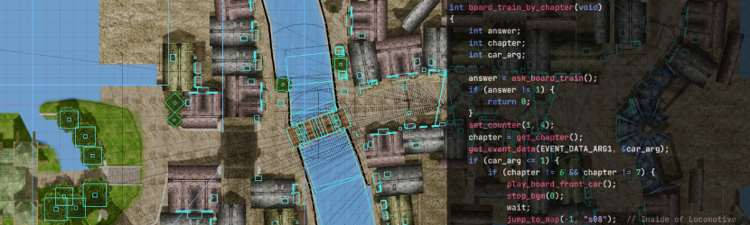

# dc1tk: DC2-Toolkit for Dark Cloud 1

This fork of [DC2-Toolkit](https://github.com/fakegenie/DC2-Toolkit) (MIT) adds **Dark Cloud 1** (PAL), as the
[Chronicle](https://github.com/TheMoonPeople/Chronicle) PC port reads it, and packages edits as
[MoonMod](https://github.com/Jeffiest/MoonMod) mods. Everything DC2-Toolkit does for Dark Chronicle still works.

For Dark Cloud 1 it extracts, converts and rebuilds, byte for byte when nothing was edited:

- **Scripts**: every monster AI and event script (.stb) to C with the game's native function names, and back.
- **Models**: characters (with their animations), dungeon floor pieces with their floor/wall and camera collision,
  Georama town parts, to glTF; textures to PNG.
- **Maps**: dungeon floor scripts (lights, fog, pieces, torches), Georama scenes and town layouts.
- **Text**: every message file, in the PC port's `lang/` JSON format.
- **Sound**: sound banks to WAV and SoundFont, sequences to MIDI.
- **Mods**: `dc2tk mod-pack` makes a MoonMod package from your edits. It checks every file against the size limit of the
  game's file and makes room when it can.

Read **[DC1.md](DC1.md)** for the commands. No game files are included: you need your own PAL copy, extracted by the
Chronicle port.

---

# DC2-Toolkit

  

  <a href="https://fakegenie.github.io/DC2-Toolkit/"><b>Documentation</b></a>
  &nbsp;&nbsp;·&nbsp;&nbsp;
  <a href="https://github.com/fakegenie/DC2-Toolkit/releases"><b>Download Releases</b></a>

**DC2-Toolkit / dc2tk** is a set of tools for modifying the PS2 game Dark Chronicle/Dark Cloud 2. With them you can extract or modify almost everything in the game and even create total conversions. We support extracting, converting and injecting:

- **Scripting** DC2 heavily uses its own scripting language for almost all behaviour in the game. dc2tk can extract all the game's scripts as human readable C code, and compile them back into the game's original bytecode format.
- **Mapping** All game maps can be extracted to modern formats, and we provide a Blender plugin to help editing/creating them and a compiler to convert them to the original DC2 Format.
- **Models/Textures/Audio** We can extract and convert all to gltf/png/wav/midi files, and can convert them all back. 
- **Text/Config/Data** Menus, dialogue, shop items, etc in every language, all editable as text and json files

The goal of this project is to support converting from and to the original game formats, not creating anything new. All tools support doing a full byte-identical round-trip. The tools can output an updated .iso image you can play on a ps2 or emulator, and probably most recomp ports.

> **No game files are included.** This repository holds tools and documentation,
> not decompiled code or assets. You need your own legally obtained copy of a
> PAL PS2 version of the game for anything here to work.

## Quick Start

- Download the latest release.
- Extract the zip somewhere and copy your PAL iso to the folder as "dc2.iso"
- Run `dc2tk setup dc2.iso`. This will extract all the assets on the disc to `extracted/`
- Optionally install the Blender plugin from the releases page.
- Make a mod in `mods/`, or edit the scripts and assets in `extracted/` and package them with `dc2tk mod make dc2.iso my-mod`. See the documentation for how-tos.
- Run `dc2tk build extracted/scripts dc2.iso -o modded.iso --mod my-mod` to build a new iso with your changes.

## Notes

- We only support PAL at the moment
- We do not extract/decompile/compile the engine code itself, there exists other projects for this such as [ChronicleTwo](https://github.com/TheMoonPeople/ChronicleTwo)

## Prior art

[ChronicleTwo](https://github.com/TheMoonPeople/ChronicleTwo), [OpenCloud](https://github.com/Gundorada-Workshop/OpenCloud), [SB2-File-Parser](https://github.com/ArsonAssassin/SB2-File-Parser), [DarkCloud-Two-Reforged](https://github.com/ZeldoKavira/DarkCloud-Two-Reforged), [DarkCloud-Toolkit](https://github.com/Gundorada-Workshop/DarkCloud-Toolkit)

## Licence

dc2tk, its SDK, definitions, Blender add-on and documentation are under the [MIT licence](LICENCE). Dark Chronicle and its content (code, art, text, audio, and screenshots of it such as `docs/images/header.png`) belong to their owners and are not covered by it. A release zip also carries `THIRD-PARTY-LICENCES.md`, the licences of the libraries built into dc2tk.
